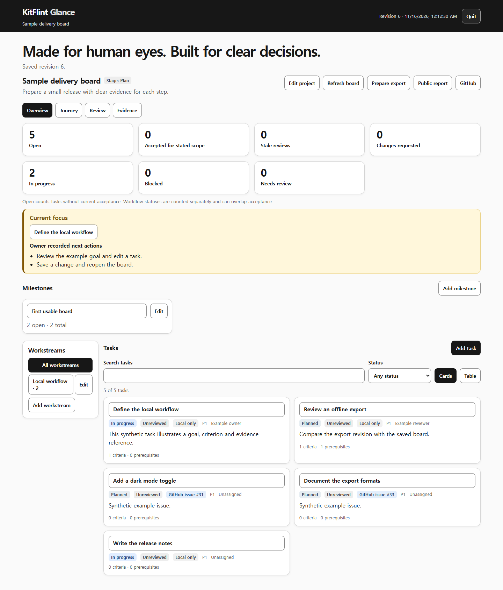

# KitFlint Glance

**Made for human eyes. Built for clear decisions.**

> [!IMPORTANT]
> **v0.1.0 pre-release · Windows x64 only.** macOS and Linux aren't supported yet; Glance won't start there. Tested on Windows 11 with Node.js 24.22.1 and npm 12.2.2.

The Glance board, captured from the real v0.1.0 app with the editable sample and two example GitHub issues. All data is synthetic.

Glance is a free, MIT-licensed, local-first project board. The v0.1.0 pre-release is Windows x64 only; macOS and Linux aren't supported yet. Use the visual dashboard to see the saved revision, focus, milestones, workstreams and evidence. Create a blank board or try the editable sample without an assistant or GitHub account.

**Website and setup guide with screenshots: [kitflint.com/glance](https://kitflint.com/glance/)**

## Quick start

You need Windows x64, Node.js **24.22.1** and npm **12.2.2**. Download the source archive from the [v0.1.0 release](https://github.com/kitflint/glance/releases/tag/v0.1.0), unpack it and open a terminal in that directory.

~~~powershell
node --version   # v24.22.1
npm --version    # 12.2.2
npm ci --ignore-scripts --no-audit --no-fund --strict-ssl=true --engine-strict=true --registry=https://registry.npmjs.org --fetch-retries=0 --fetch-timeout=30000 --update-notifier=false
npm start -- --root "D:/Boards/MyProject"
~~~

Use a separate, empty board directory on a local NTFS volume. Open the printed link within two minutes and keep it private: it carries a one-use launch code. The [Quickstart](docs/QUICKSTART.md) covers certificates, restoring a backup and removing Glance.

1. Edit and save a task. Workflow status (**Planned**, **In progress**, **Needs review** or **Blocked**), GitHub issue state and current human acceptance are separate. Use **Review task** to record what you checked.
2. Use **Public report** to preview a shareable snapshot. Keep a full private JSON backup for restoration.
3. Choose **Quit** and confirm that the foreground process exits before reopening.

## Connect your AI assistant (MCP)

Glance includes a local MCP server over stdio, with no network listener. It is read-only by default with seven tools; a guarded update tool is added only with the final argument `--allow-writes`. Replace the example paths with your own absolute paths.

Claude Code (tested 2.1.325):

~~~powershell
claude mcp add glance -- "C:/Tools/node/node.exe" "D:/Apps/kitflint-glance/src/mcp-main.ts" --root "D:/Boards/MyProject"
~~~

Claude Desktop (tested 5.11492.5.0): **Settings** → **Developer** → **Edit Config**, add this under `mcpServers`, then restart.

~~~json
{
  "mcpServers": {
    "glance": {
      "command": "C:/Tools/node/node.exe",
      "args": ["D:/Apps/kitflint-glance/src/mcp-main.ts", "--root", "D:/Boards/MyProject"]
    }
  }
}
~~~

Other clients that launch a local stdio server, such as Cursor, may work but have not been tested. Ask the assistant to call `glance_list_tasks` first. The update tool cannot record human acceptance, publish to GitHub, delete a board or run commands. See [Local MCP tools](docs/MCP.md) and the [instructions for AI agents](https://kitflint.com/glance/AGENTS.md).

## Documentation

| If you want to | Read |
| --- | --- |
| Try the first-use workflow on a disposable board | [First-use checklist](docs/FIRST-USE-CHECKLIST.md) |
| Give feedback in the independent local pilot | [Pilot feedback worksheet](docs/PILOT-FEEDBACK.md) |
| Record scoped human acceptance, export or recover a board | [Backup and recovery](docs/BACKUP-RECOVERY.md) |
| Read a saved board with a local assistant or opt in to local updates | [Local MCP tools](docs/MCP.md) |
| Understand issue import, reviewed publication and the current GitHub setup limit | [GitHub connection](docs/GITHUB.md) |
| Decide which data to share | [Privacy](docs/PRIVACY.md) |
| Check the Windows, runtime and qualification status | [Compatibility](docs/COMPATIBILITY.md) |

## Honest about what it is

Glance has no ads or trackers and loads no remote assets for the local board. Glance displays evidence locations without opening or verifying them. GitHub is optional and uses the KitFlint Glance GitHub App only after you sign in. Developer-operated checks covered the local board, both GitHub starting journeys against a private test repository, and local MCP with Claude Desktop and Claude Code. The v0.1.0 public release is published, and a fresh download of its source package passed a clean install, the full test suite and the browser journeys. Pre-release usability walkthroughs were simulated, not run with real users, so independent first-user setup remains unverified. See [Compatibility](docs/COMPATIBILITY.md) for the tested scope.

Found a bug? [Open an issue](https://github.com/kitflint/glance/issues/new/choose) with synthetic data only, never launch links, codes, tokens or private board data.

[Contributing](CONTRIBUTING.md) · [Security](SECURITY.md) · [MIT License](LICENSE) · [Third-party notices](THIRD-PARTY-NOTICES.md) · [kitflint.com](https://kitflint.com/)
